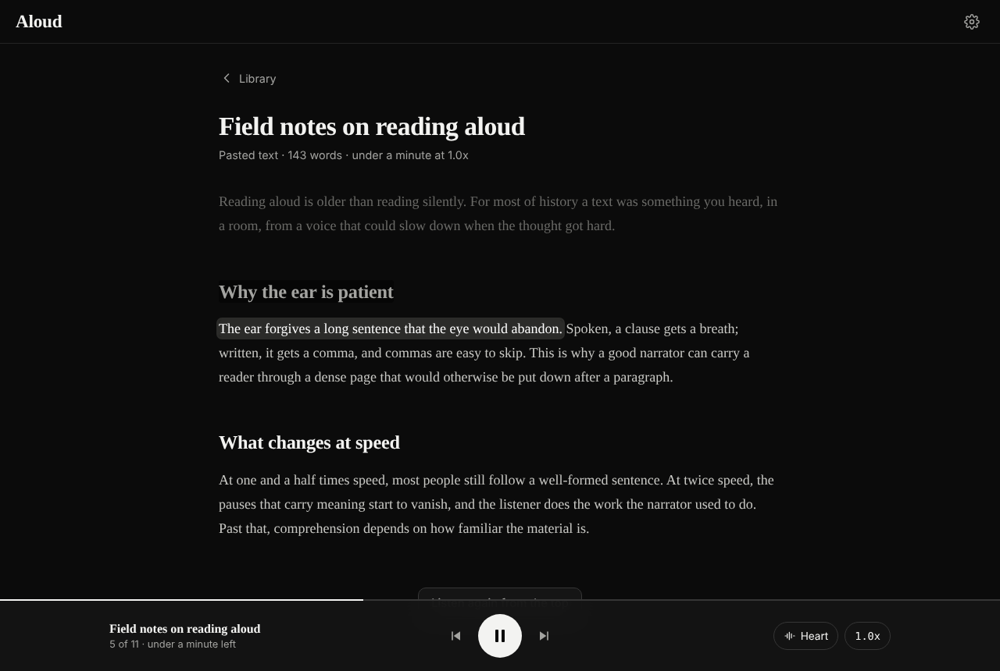

# Aloud for the web

Read anything out loud with natural voices that run on your own computer.

Aloud is the open-source web companion to [Aloud: Read Anything](https://apps.apple.com/app/id6811445406) for iPhone and iPad. Drop in a PDF, a Word file, an EPUB, some pasted text or a link to an article, press play, and follow along as each sentence is highlighted. The voices come from [Kokoro-82M](https://huggingface.co/hexgrad/Kokoro-82M), a small neural text-to-speech model that runs on the CPU through onnxruntime. No GPU, no account, no cloud, nothing leaves your machine.



## Run it

You need Docker (Docker Desktop on Mac and Windows, Docker Engine with the compose plugin on Linux).

```bash
git clone https://github.com/FLoWIsMe/aloud-web.git
cd aloud-web
docker compose up --build
```

Open http://localhost:8787. The first start downloads the voice model (about 340 MB) in the background; until it is ready, your browser's built-in voice reads instead, so you can start listening immediately. Natural voices take over at the next sentence once the model is loaded.

Without compose, the same thing as one container:

```bash
docker build -t aloud-web .
docker run -d --name aloud -p 8787:8787 -v "$PWD/data:/data" aloud-web
```

Everything that matters lives in `./data`: your library (`aloud.sqlite3`), the voice model (`models/`) and the audio cache (`cache/`). Back it up by copying the folder.

## What it does

- **Reads almost anything.** PDF, Word (.docx), EPUB, Markdown, HTML, RTF and plain text uploads; pasted text; or a link, which is fetched from your computer and reduced to the article itself without menus and footers. Drag files onto the library to add them.
- **Sentence by sentence.** The text is split into sentences on the server. Each one is synthesized once, cached on disk and highlighted while it plays. Click any sentence to jump there.
- **54 natural voices in 9 languages.** American and British English, Spanish, French, Hindi, Italian, Japanese, Brazilian Portuguese and Mandarin, each with a one-tap preview. The browser's own voices are there too.
- **0.5x to 5x in 0.1x steps.** Speed changes apply instantly and never require re-synthesis, since playback rate is handled in the browser with pitch preserved.
- **Never strands you.** If the model download fails you see why and get a Retry; the browser voice keeps reading in the meantime. A partial download resumes where it left off.
- **Remembers your place** in every document, plus your voice, speed and theme.
- **Keyboard first.** Space plays and pauses, the arrow keys skip a sentence, the bracket keys nudge the speed.
- **Light and dark**, serif reading column, installable as a web app from the browser menu.

## Configuration

Set these in `docker-compose.yml` or with `-e` on `docker run`.

| Variable | Default | Meaning |
| --- | --- | --- |
| `ALOUD_PORT` | `8787` | Port inside the container (map it with `-p`). |
| `ALOUD_DATA_DIR` | `/data` | Where the library, model and cache live. |
| `ALOUD_AUTO_DOWNLOAD` | `1` | Download the voice model on start. Set `0` to download only from Settings. |
| `ALOUD_CACHE_MAX_MB` | `2048` | Cap for cached audio; least recently played sentences are evicted first. |
| `ALOUD_THREADS` | `0` | CPU threads for synthesis; `0` lets onnxruntime pick. |
| `ALOUD_MAX_UPLOAD_MB` | `50` | Largest file accepted. |
| `ALOUD_KOKORO_MODEL_URL` | GitHub release | Where to fetch `kokoro-v1.0.onnx`. |
| `ALOUD_KOKORO_VOICES_URL` | GitHub release | Where to fetch `voices-v1.0.bin`. |
| `ALOUD_TTS_ENGINE` | `kokoro` | `stub` plays tones instead of speech; used by the tests. |
| `PUID` / `PGID` | `1000` | Owner of the files in `./data` on Linux hosts (`id -u`, `id -g`). |

Offline machines: put `kokoro-v1.0.onnx` and `voices-v1.0.bin` from the [kokoro-onnx model release](https://github.com/thewh1teagle/kokoro-onnx/releases/tag/model-files-v1.0) into `./data/models/` before starting and no download happens.

There is no login. By default the compose file publishes port 8787 on every interface of your computer, which is convenient for listening from a phone on the same Wi-Fi. If other people share that network, change the mapping to `127.0.0.1:8787:8787` or put Aloud behind a reverse proxy that handles authentication.

## How it works

```
browser (vanilla JS, no build step)          FastAPI server (Python 3.12)
  library and reader views          <--->     /api/documents  import, list, progress
  player: one <audio> element,                /api/documents/{id}/audio/{n}  WAV per sentence
    prefetches the next sentences              /api/tts  model status, voices, previews, cache
    falls back to speechSynthesis              /api/settings
                                              SQLite in /data, Kokoro via onnxruntime (CPU)
```

Importing extracts text into blocks (headings and paragraphs) with pypdf, python-docx, ebooklib, markdown-it-py and trafilatura, then splits each block into sentences with a small abbreviation-aware splitter. Very long sentences are broken at clause boundaries so the first audio arrives quickly. Every sentence is a chunk with an index; the reader renders one `<span>` per chunk and the player asks the server for chunk audio in order, prefetching a few ahead. The server synthesizes on a single worker, deduplicates concurrent requests for the same sentence and caches the WAV under a hash of engine, voice and text.

On a laptop CPU Kokoro runs at several times real time, so after the first sentence the audio stays ahead of playback. In this repository's sandbox (two cores) it measured about 1.7x real time with the fp32 model.

## Develop

```bash
python -m venv .venv && source .venv/bin/activate
pip install -r requirements.txt pytest ruff
python -m server                       # http://localhost:8787, data in ./data
python -m pytest -q                    # 38 tests, no model needed (stub engine)
ruff check server tests && ruff format --check server tests
```

`ALOUD_TTS_ENGINE=stub python -m server` runs the whole app without the model, which is handy for working on the UI. The optional browser smoke test in `scripts/e2e_smoke.mjs` walks the real interface with Playwright against a running server.

Layout:

```
server/            FastAPI app
  extract.py       file, text and URL extraction into blocks
  segment.py       sentence splitting and chunking
  tts/             Kokoro engine, model download manager, audio cache, synth service
  api/             documents, tts, settings routers
web/               static frontend (index.html, styles.css, js/)
tests/             pytest suite using the stub engine
docker/            container entrypoint
```

## Differences from the iOS app

The iOS app is paid and uses accounts for sync; this one has no accounts, no paywall, no analytics and no telemetry. Pocket TTS, the second voice engine on iOS, is not included here yet; the engine interface in `server/tts/base.py` is the place to add it. Scanned PDFs need OCR before import (the app will tell you when a PDF has no text layer).

## Credits

- [Kokoro-82M](https://huggingface.co/hexgrad/Kokoro-82M) by hexgrad (Apache-2.0) and the ONNX export and runtime from [kokoro-onnx](https://github.com/thewh1teagle/kokoro-onnx) (MIT).
- Phonemization through [espeak-ng](https://github.com/espeak-ng/espeak-ng) (GPL-3.0), loaded at runtime as a separate library.
- Article extraction by [trafilatura](https://github.com/adbar/trafilatura).

Aloud for the web is released under the Apache License 2.0. See `LICENSE`.
